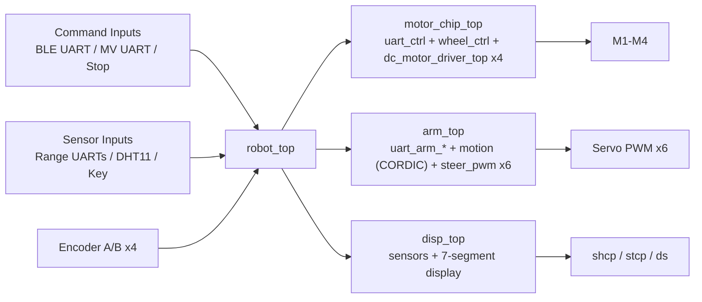

# RoboMotion-FPGA

FPGA-Based Omnidirectional Mobile Manipulator Control System

[中文文档](README_CN.md)

> **Award:** National Second Prize, 2024 National College Student Integrated Circuit Innovation and Entrepreneurship Competition

---

## Overview

RoboMotion-FPGA is a Verilog HDL control system for a mobile manipulation robot, targeting Xilinx FPGA platforms. It integrates an omnidirectional four-wheel chassis, a six-servo robotic arm, sensor and display peripherals, and multiple UART command interfaces into a single top-level hardware design.

- Target device: Xilinx FPGA (see `constrain/*.xdc` for pin assignments)
- Toolchain: Xilinx Vivado
- Language: Verilog HDL (56 modules)

## Features

- **Mobile chassis** — 4-channel DC motor drive with encoder feedback, PWM output, and speed PID closed-loop control.
- **Kinematics** — Three motion models selectable at runtime over UART: mecanum, 4-wheel omni, 3-wheel omni.
- **Robotic arm** — 6-channel servo PWM with CORDIC-based inverse kinematics for positioning and gripper control.
- **Multi-channel UART** — Bluetooth control, machine-vision input, configuration ACK TX, and FSM-based command parsing.
- **Sensors and display** — DHT11 temperature/humidity, three UART distance inputs, push-button inputs, and a 74HC595-driven 7-segment display.

## Architecture

```text
robot_top
├── disp_top
│   ├── hex_top / hc595_driver
│   ├── dht11_ctrl
│   ├── distance ×3
│   ├── uart_ble
│   └── switch_key_filter
├── motor_chip_top
│   ├── wheel_ctrl
│   │   ├── Mcknum_wheel_calculate
│   │   ├── all_direction_wheel_four_calculate
│   │   ├── all_direction_wheel_three_calculate
│   │   └── dc_motor_driver_top ×4
│   │       ├── encoder / encoder_AB_detect
│   │       ├── controller / controller_PID / controller_Speed_loop
│   │       ├── pwm_generate
│   │       └── dc_motor_driver
│   └── uart_ctrl
│       ├── fsm_gr / fsm_ppr / fsm_wheel / fsm_a_len / fsm_b_len / fsm_baud
│       ├── uart_cmd / dance_cmd
│       ├── multiplier / divider
│       └── uart_data_tx
└── arm_top
    ├── motion
    │   ├── cordic_sincos
    │   ├── cordic_arctan
    │   └── cordic_arccos
    ├── steer_pwm ×6
    ├── uart_arm_mv
    └── uart_arm_ble
```



## Modules

| Subsystem | Top Module | Key Files |
|:---|:---|:---|
| System integration | `robot_top.v` | Connects chassis, arm, display, sensors, UART channels |
| Chassis control | `motor_chip_top.v` | `wheel_ctrl.v`, `dc_motor_driver_top.v`, `uart_ctrl.v` |
| Wheel kinematics | `wheel_ctrl.v` | `Mcknum_wheel_calculate.v`, `all_direction_wheel_four_calculate.v`, `all_direction_wheel_three_calculate.v` |
| Motor driver | `dc_motor_driver_top.v` | `controller.v`, `controller_PID.v`, `encoder.v`, `pwm_generate.v` |
| Robotic arm | `arm_top.v` | `motion.v`, `steer_pwm.v`, `uart_arm_ble.v`, `uart_arm_mv.v` |
| CORDIC math | `motion.v` | `cordic_sincos.v`, `cordic_arctan.v`, `cordic_arccos.v`, `cordic_arctanh.v` |
| Sensors and display | `disp_top.v` | `dht11_ctrl.v`, `distance.v`, `hc595_driver.v`, `hex_top.v` |

## UART Protocol

Successful configuration commands return `Set Successful!` over UART. Command parsing is a mix of ASCII keyword commands and fixed binary frames.

| Category | Command | Description | Example / Range |
|:---|:---|:---|:---|
| System | `baud+<n>` | Set UART baud preset | `baud+0` – `baud+4` |
| Motion | `wheel+<n>` | Select wheel kinematics model | `wheel+0` mecanum, `wheel+1` 4-wheel omni, `wheel+2` 3-wheel omni |
| Config | `gr+<value>` | Set gear ratio | `gr+30` |
| Config | `Ppr+<value>` | Set encoder PPR | `Ppr+13` |
| Config | `alen+<mm>` | Set chassis dimension A | `alen+200` |
| Config | `blen+<mm>` | Set chassis dimension B | `blen+150` |
| Control | `55 A5 sx x sy y sz z F0` | Chassis speed frame; `sx/sy/sz`: `00` positive, `01` negative | |
| Action | `55 C5 mode F0` | Preset dance control frame; `mode=01` start, `mode=00` reset | |
| Arm BLE | `DD EE ... FF` | Arm action frame: observe / move / pack / put / catch | Parsed by `uart_arm_ble.v` |
| Arm MV | `AA BB ... CC` | Vision target frame: color, signed X/Y, theta | Parsed by `uart_arm_mv.v` |

## Repository Layout

```text
RoboMotion-FPGA/
├── verilog/                  # 56 hardware source files
│   ├── rtl/
│   │   ├── top/              # System tops (robot_top, arm_top, motor_chip_top, ...)
│   │   ├── comm/             # UART communication (uart_*, fsm_baud)
│   │   ├── motion/           # Kinematics and motion control
│   │   ├── motor/            # Motor driver, PID, encoder, PWM
│   │   ├── math/             # CORDIC, multiplier, divider
│   │   ├── peripheral/       # Sensor, display, timer, key filter
│   │   └── protocol/         # FSM protocol parsers (fsm_gr, fsm_ppr, ...)
│   ├── filelists/            # Legacy filelists (Windows absolute paths)
│   ├── tb/                   # Testbench directory (currently empty)
│   └── sim/                  # Simulation directory (currently empty)
├── constrain/                # Pin constraints
│   ├── robot_top_constrain.xdc
│   └── disp_top_constrain.xdc
└── README.md / README_CN.md
```

## Development Environment

- Xilinx Vivado — synthesis, implementation, timing analysis, bitstream generation
- Target hardware: Xilinx FPGA; see the `.xdc` files for package pin assignments

## Quick Start

1. Create a new project in Xilinx Vivado.
2. Add all Verilog sources from `verilog/rtl/`.
3. Add XDC constraints from `constrain/`.
4. Regenerate or replace the bundled filelists if your toolflow cannot use the legacy Windows absolute paths in `verilog/filelists/`.
5. Set `robot_top.v` as the system top module.
6. Run Synthesis → Implementation → Generate Bitstream.
7. Download the bitstream to the FPGA board.

## License

This project is intended for educational and research use.
