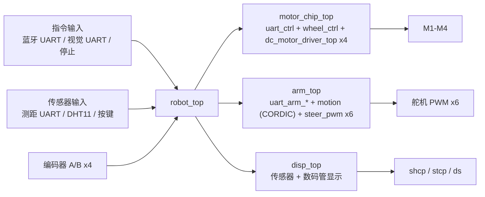

# RoboMotion-FPGA

基于 FPGA 的全向移动机械臂控制系统

[English](README.md)

> **获奖：2024 年全国大学生集成电路创新创业大赛（集创赛）国家二等奖**

---

## 项目概述

RoboMotion-FPGA 是一个面向 Xilinx FPGA 平台的 Verilog HDL 机器人控制系统，将全向四轮移动底盘、六路舵机机械臂、传感器与显示外设，以及多路 UART 指令接口集成到统一的顶层硬件设计中。

- 目标器件：Xilinx FPGA（引脚分配见 `constrain/*.xdc`）
- 开发工具：Xilinx Vivado
- 设计语言：Verilog HDL（56 个模块）

## 功能特性

- **移动底盘** — 4 路直流电机驱动，集成编码器反馈、PWM 输出与速度 PID 闭环控制。
- **运动学模型** — 支持麦克纳姆轮、全向四轮、全向三轮三种模型，可通过 UART 实时切换。
- **机械臂控制** — 6 路舵机 PWM 输出，基于 CORDIC 算法的逆运动学解算，用于机械臂定位与夹爪控制。
- **多路 UART 通信** — 蓝牙控制、机器视觉输入、配置成功回传、FSM 指令解析。
- **传感器与显示** — DHT11 温湿度、3 路 UART 测距输入、按键输入、74HC595 驱动的数码管显示。

## 系统架构

```text
robot_top
├── disp_top
│   ├── hex_top / hc595_driver
│   ├── dht11_ctrl
│   ├── distance ×3
│   ├── uart_ble
│   └── switch_key_filter
├── motor_chip_top
│   ├── wheel_ctrl
│   │   ├── Mcknum_wheel_calculate
│   │   ├── all_direction_wheel_four_calculate
│   │   ├── all_direction_wheel_three_calculate
│   │   └── dc_motor_driver_top ×4
│   │       ├── encoder / encoder_AB_detect
│   │       ├── controller / controller_PID / controller_Speed_loop
│   │       ├── pwm_generate
│   │       └── dc_motor_driver
│   └── uart_ctrl
│       ├── fsm_gr / fsm_ppr / fsm_wheel / fsm_a_len / fsm_b_len / fsm_baud
│       ├── uart_cmd / dance_cmd
│       ├── multiplier / divider
│       └── uart_data_tx
└── arm_top
    ├── motion
    │   ├── cordic_sincos
    │   ├── cordic_arctan
    │   └── cordic_arccos
    ├── steer_pwm ×6
    ├── uart_arm_mv
    └── uart_arm_ble
```



## 核心模块

| 子系统 | 顶层模块 | 关键文件 |
|:---|:---|:---|
| 系统集成 | `robot_top.v` | 连接底盘、机械臂、显示、传感器与各 UART 通道 |
| 底盘控制 | `motor_chip_top.v` | `wheel_ctrl.v`、`dc_motor_driver_top.v`、`uart_ctrl.v` |
| 轮式运动学 | `wheel_ctrl.v` | `Mcknum_wheel_calculate.v`、`all_direction_wheel_four_calculate.v`、`all_direction_wheel_three_calculate.v` |
| 电机驱动 | `dc_motor_driver_top.v` | `controller.v`、`controller_PID.v`、`encoder.v`、`pwm_generate.v` |
| 机械臂 | `arm_top.v` | `motion.v`、`steer_pwm.v`、`uart_arm_ble.v`、`uart_arm_mv.v` |
| CORDIC 运算 | `motion.v` | `cordic_sincos.v`、`cordic_arctan.v`、`cordic_arccos.v`、`cordic_arctanh.v` |
| 传感器与显示 | `disp_top.v` | `dht11_ctrl.v`、`distance.v`、`hc595_driver.v`、`hex_top.v` |

## UART 协议

配置类指令执行成功后会通过 UART 回传 `Set Successful!`。指令解析混合了 ASCII 关键字指令与固定二进制帧两种形式。

| 类别 | 指令 | 说明 | 示例 / 范围 |
|:---|:---|:---|:---|
| 系统 | `baud+<n>` | 设置 UART 波特率档位 | `baud+0` – `baud+4` |
| 运动 | `wheel+<n>` | 选择轮式运动学模型 | `wheel+0` 麦克纳姆轮、`wheel+1` 全向四轮、`wheel+2` 全向三轮 |
| 配置 | `gr+<value>` | 设置减速比 | `gr+30` |
| 配置 | `Ppr+<value>` | 设置编码器线数 | `Ppr+13` |
| 配置 | `alen+<mm>` | 设置底盘尺寸 A | `alen+200` |
| 配置 | `blen+<mm>` | 设置底盘尺寸 B | `blen+150` |
| 控制 | `55 A5 sx x sy y sz z F0` | 底盘速度帧；`sx/sy/sz`：`00` 为正，`01` 为负 | |
| 动作 | `55 C5 mode F0` | 预设跳舞控制帧；`mode=01` 启动，`mode=00` 复位 | |
| 机械臂蓝牙 | `DD EE ... FF` | 机械臂动作帧：观察 / 移动 / 收纳 / 放置 / 抓取 | 由 `uart_arm_ble.v` 解析 |
| 机械臂视觉 | `AA BB ... CC` | 视觉目标帧：颜色、带符号 X/Y、角度 theta | 由 `uart_arm_mv.v` 解析 |

## 仓库结构

```text
RoboMotion-FPGA/
├── verilog/                  # 56 个硬件源码文件
│   ├── rtl/
│   │   ├── top/              # 系统顶层（robot_top、arm_top、motor_chip_top 等）
│   │   ├── comm/             # UART 通信（uart_*、fsm_baud）
│   │   ├── motion/           # 运动学与运动控制
│   │   ├── motor/            # 电机驱动、PID、编码器、PWM
│   │   ├── math/             # CORDIC、乘法器、除法器
│   │   ├── peripheral/       # 传感器、显示、定时器、按键消抖
│   │   └── protocol/         # FSM 协议解析（fsm_gr、fsm_ppr 等）
│   ├── filelists/            # 历史文件列表（含 Windows 绝对路径）
│   ├── tb/                   # 测试平台目录（当前为空）
│   └── sim/                  # 仿真目录（当前为空）
├── constrain/                # 引脚约束
│   ├── robot_top_constrain.xdc
│   └── disp_top_constrain.xdc
└── README.md / README_CN.md
```

## 开发环境

- Xilinx Vivado — 综合、实现、时序分析与比特流生成
- 目标硬件：Xilinx FPGA，封装引脚分配见 `.xdc` 约束文件

## 快速开始

1. 在 Xilinx Vivado 中新建工程。
2. 添加 `verilog/rtl/` 下的全部 Verilog 源码。
3. 添加 `constrain/` 下的 XDC 约束文件。
4. 如果工具流无法直接使用 `verilog/filelists/` 中的旧版 Windows 绝对路径，请重新生成或替换文件列表。
5. 将 `robot_top.v` 设置为系统顶层模块。
6. 依次执行综合（Synthesis）→ 实现（Implementation）→ 生成比特流（Generate Bitstream）。
7. 下载比特流到 FPGA 开发板。

## 许可说明

本项目用于教学与科研用途。
